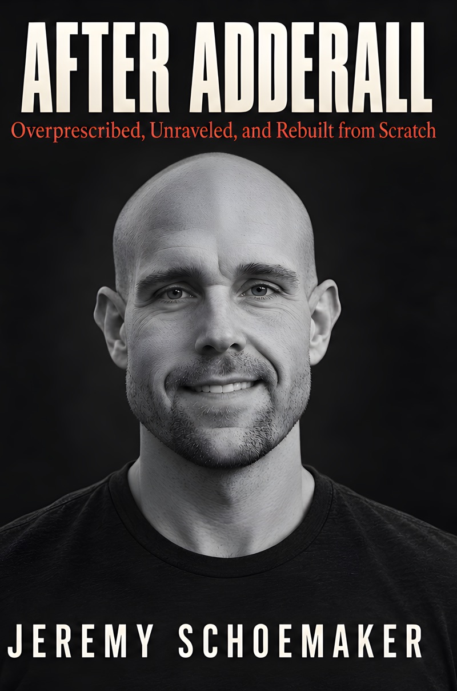
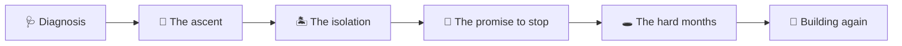

<div align="center">

# 💊 After Adderall

### *Overprescribed, Unraveled, and Rebuilt from Scratch*

**A free memoir by Jeremy Schoemaker** 📖

[](#-read-it-free)
[](https://cdn.shoemoney.com/books/after-adderall.pdf)
[](https://cdn.shoemoney.com/books/after-adderall.epub)
[](https://www.amazon.com/dp/B0HKHL79R7)



> *"Quiet is not the same as gone. I needed to read that in my own handwriting."*

</div>

---

## 🧠 About the book

For Jeremy Schoemaker, Adderall seemed to offer the mind he had always wanted: focused, tireless, capable of turning ideas into working things. Then the work consumed the life it was supposed to improve.

**After Adderall** follows the ascent, the isolation, the promise to stop, and the months when even opening a laptop felt impossible. With blunt honesty and hard-earned humor, Schoemaker confronts the question underneath it all: if the pill was gone, what was left of him?

The answer came slowly, in a marriage, in ordinary mornings, and in small pieces of work that began to add up. This is his account of coming apart and learning to build again. 🔧

## 📥 Read it free

The full book is free. No email signup, no paywall, no catch. 🎁

| Format | Link | Best for |
|---|---|---|
| 📄 **PDF** | [after-adderall.pdf](https://cdn.shoemoney.com/books/after-adderall.pdf) | Desktop, tablets, printing |
| 📱 **EPUB** | [after-adderall.epub](https://cdn.shoemoney.com/books/after-adderall.epub) | Apple Books, Kobo, Thorium, most e-readers |
| 🔥 **Kindle** | [Amazon](https://www.amazon.com/dp/B0HKHL79R7) | Kindle devices and app |
| 📘 **Paperback** | [Amazon](https://www.amazon.com/dp/B0HKHNG63B) | Holding a real book |
| 📗 **Hardcover** | [Amazon](https://www.amazon.com/dp/B0HKHHT6YQ) | Your shelf |

> 💡 The print and Kindle editions are priced at the lowest list price Amazon allows. They exist for people who prefer them, not for profit.

## 🗺️ The arc



## 📚 Contents

| # | Chapter |
|---|---|
| 1 | Nineteen Times Since September |
| 2 | I Watched a Bradley Cooper Movie and Called My Psychiatrist |
| 3 | Forty Milligrams and a PHP Framework |
| 4 | There but Not Really There |
| 5 | Counting My Ribs in the Mirror |
| 6 | Move My House Into Your Garage, I'll Wire You Ten Grand |
| 7 | Is Getting Out of Bed Worth It. |
| 8 | Flowers for Algernon |
| 9 | `echo "hello world"` |
| 10 | The Laptop Lived on the Kitchen Island |
| 11 | Quiet Is Not the Same as Gone |
| 📎 | Notes on Sources |

## 🙋 Who it's for

- 🧩 Adults diagnosed with ADHD later in life
- 💊 Anyone whose relationship with a stimulant prescription stopped feeling like treatment
- 💻 Developers, founders, and builders who mistook output for wellbeing
- ❤️ Partners and families watching someone they love disappear into work

## 🆘 If you're struggling

This is one person's story, not medical advice. **Please don't stop or change a prescription without talking to the clinician who prescribed it.** Stopping stimulants abruptly can bring on serious withdrawal symptoms, including depression.

| 🇺🇸 Resource | Contact |
|---|---|
| SAMHSA National Helpline (free, confidential, 24/7) | 📞 1-800-662-4357 · [samhsa.gov/find-help/helplines/national-helpline](https://www.samhsa.gov/find-help/helplines/national-helpline) |
| 988 Suicide & Crisis Lifeline | 📞 Call or text **988** · [988lifeline.org](https://988lifeline.org) |

Outside the US, [findahelpline.com](https://findahelpline.com) lists free crisis lines by country. 🌍

## 🔗 Share it

If this book might help someone, send them this page or the PDF link directly. That's the whole marketing plan. 📣

```text
https://github.com/shoemoney/after-adderall
```

## ⚖️ Copyright

© 2026 Jeremy Schoemaker. All rights reserved. The book is free to download and read from the links above.

---

<div align="center">

*Built from scratch. Again.* 🧱

</div>
